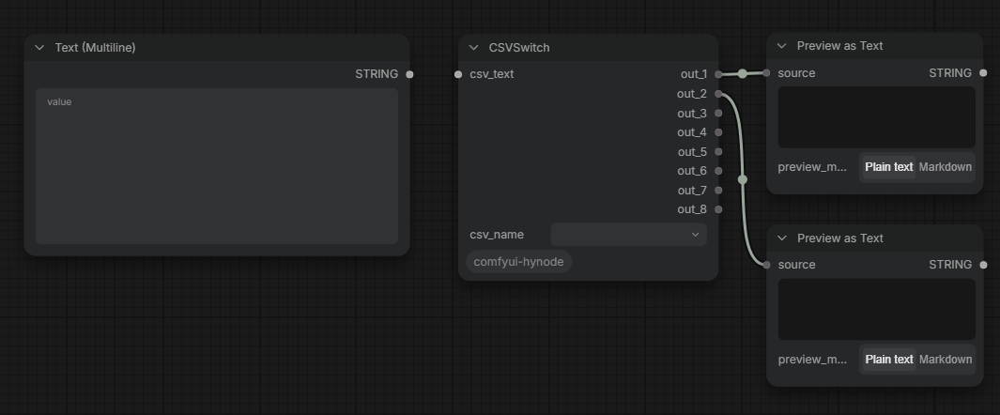

# ComfyUI-HYNode

[](LICENSE)

# Get Started

## Install

1. Clone this repo into `custom_modules`:
    ```
    cd ComfyUI/custom_nodes
    git clone https://github.com/hyunxuuu/ComfyUI-HYNode.git
    ```
1. Start up ComfyUI.

# Nodes

## CSVSwtich

* Input STRING in `csv_text`.
* Write CSV text and Click node to reflash.
    ```
    "(No Care)", "Lable1", "Lable2"
    "Output STRING:", "123", "Use \\ escape \""
    "Output INT", 123
    "Output FLOAT", 1.23
    "Output BOOLEAN", "$True", "$False"
    ```
* Choose an option in `csv_name` and Preview your output.

* Check for error in "Toast" or "Execution failed".

